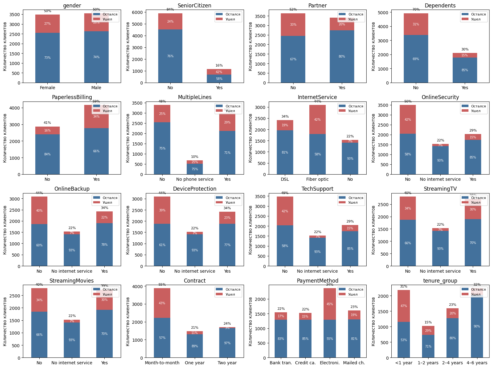
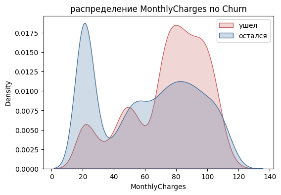

# Отток клиентов телеком-компании

Почему клиенты уходят от оператора связи и можно ли заранее предсказать, кто уйдет следующим. Анализ и классификация на датасете [Telco Customer Churn](https://www.kaggle.com/datasets/blastchar/telco-customer-churn) от IBM: 7 043 клиента, 21 признак, из них за последний месяц ушло 26.5%.

Весь анализ в ноутбуке [`telco_churn_analysis.ipynb`](telco_churn_analysis.ipynb).

## Главное

- Сильнее всего отток зависит от типа договора. На помесячном договоре уходят 43% клиентов, на двухлетнем 3%.
- Самый рискованный период первый год: среди новых клиентов ушло 47%, среди тех, кто с компанией 4-6 лет, только 10%.
- Чаще уходят клиенты с оптоволокном (42%), с оплатой электронным чеком (45%) и пенсионеры (42%).
- Клиенты с техподдержкой или онлайн-безопасностью уходят почти в 3 раза реже: 15% против 42%. Пол на отток не влияет.
- Лучшие модели (градиентный бустинг, логистическая регрессия, перцептрон) дают ROC-AUC около 0.84 на тестовой выборке.
- Тщательная предобработка почти не повысила метрики по сравнению с сырыми данными. Она сделала данные чище и понятнее, но сигнал об оттоке модели находят и без нее.



## Что я сделала

### Очистка

`TotalCharges` в исходном файле хранится строкой, и у 11 клиентов вместо суммы стоит пробел. Оказалось, что у всех них `tenure = 0`: это новые клиенты, которые еще ни разу не платили. Таких строк мало, поэтому я их удалила. `SeniorCitizen` перевела в категориальный признак, `TotalCharges` в числовой и сгладила кубическим корнем, потому что у него длинный правый хвост.

### Избыточные признаки

`PhoneService` полностью восстанавливается из `MultipleLines` (проверила на всех строках), поэтому я его удалила. Значение `No internet service` встречается у 22% клиентов в шести столбцах сразу. Удалять или заменять его на `No` заранее я не стала: сначала закодировала признаки, а потом по матрице Cramér's V убедилась, что все столбцы `*_No internet service` совпадают с `InternetService_No`, и оставила только его.

### Описательный анализ

Распределения признаков и их связь с оттоком, корреляция Пирсона для числовых признаков, Cramér's V для категориальных, point-biserial для пар «бинарный и числовой».

### Обучение без учителя

KMeans выделил 3 группы клиентов, и в одной из них ушло 48% против 8% и 16% в двух других. IsolationForest нашел 5% необычных клиентов, и уходят они реже среднего (17% против 27%). Эти признаки я использовала только для анализа, в модели они не попали: их считали на всех данных, включая тестовую часть, и это была бы утечка.

### Модели

Логистическая регрессия, многослойный перцептрон, случайный лес, градиентный бустинг, KNN, SVM и наивный байес. Стратифицированное разбиение 80/20, 5-fold кросс-валидация на обучающей части, метрики accuracy, precision, recall, F1 и ROC-AUC.



Пик около $20 на графике выше - это клиенты без интернета, которые платят только за телефон. Они уходят реже всех (7%).

## Результаты

Метрики на тестовой выборке (1 407 клиентов) после предобработки:

| Модель | ROC-AUC | F1 | Precision | Recall |
|---|---:|---:|---:|---:|
| Градиентный бустинг | 0.841 | 0.58 | 0.63 | 0.54 |
| Многослойный перцептрон | 0.838 | 0.58 | 0.65 | 0.52 |
| Логистическая регрессия | 0.837 | 0.58 | 0.63 | 0.53 |
| Наивный байес | 0.829 | 0.61 | 0.51 | 0.75 |
| Случайный лес | 0.821 | 0.55 | 0.63 | 0.49 |
| SVM | 0.785 | 0.56 | 0.65 | 0.49 |
| KNN | 0.770 | 0.53 | 0.54 | 0.53 |

Три лучшие модели почти не отличаются по качеству, так что я бы выбрала логистическую регрессию: она обучается за доли секунды, и ее проще всего объяснить. Отдельно интересен наивный байес. По ROC-AUC он немного уступает, зато находит 75% ушедших клиентов, тогда как остальные модели около половины. Если компании дешевле лишний раз предложить скидку, чем потерять клиента, это может быть важнее.

### Помогла ли предобработка

Я обучила те же модели на исходных данных с минимальными изменениями (`TotalCharges` в число и кодирование категорий) и сравнила:

| Модель | ROC-AUC до | ROC-AUC после |
|---|---:|---:|
| Логистическая регрессия | 0.836 | 0.837 |
| Градиентный бустинг | 0.838 | 0.841 |
| Наивный байес | 0.807 | 0.829 |
| Случайный лес | 0.814 | 0.821 |

Разница в пределах того, что дает другое случайное разбиение, кроме наивного байеса. Он сильнее других моделей зависит от распределения признаков, и ему, вероятно, помогли сглаженный `TotalCharges` и удаление дублирующих столбцов. Для этого датасета вывод такой: исходные признаки и так информативны, и предобработка нужна скорее для того, чтобы данные можно было правильно интерпретировать, а не ради метрик.

## Что можно улучшить

- Подобрать гиперпараметры. Сейчас все модели обучены с настройками по умолчанию.
- Выбрать порог классификации под задачу удержания вместо стандартного 0.5. Например, по стоимости удерживающего предложения и цене потерянного клиента.
- Посмотреть, какие признаки сильнее всего влияют на предсказание модели (коэффициенты логистической регрессии, permutation importance).
- Данные - это снимок за один месяц. Чтобы предсказывать, когда именно клиент уйдет, нужна история по месяцам.

## Как запустить

```bash
pip install -r requirements.txt
jupyter notebook telco_churn_analysis.ipynb
```

Файл `WA_Fn-UseC_-Telco-Customer-Churn.csv` должен лежать в одной папке с ноутбуком. Его можно скачать с [Kaggle](https://www.kaggle.com/datasets/blastchar/telco-customer-churn).

Стек: Python, pandas, NumPy, scikit-learn, SciPy, matplotlib, seaborn.
